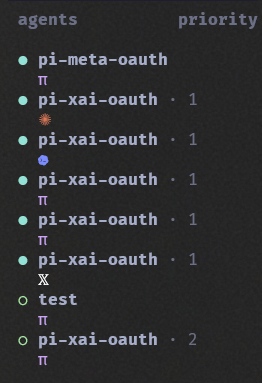

# herdr-agent-icons

A [herdr](https://herdr.dev) plugin that shows an icon instead of the agent name
(`claude`, `codex`, `grok`, `pi`, ...) in the agent sidebar, and reports the
harness name as `$harness` so the row does not have to say `Local`.



On startup, on `pane.agent_detected`, and when you run
`herdr plugin action invoke blockedpath.agent-icons.apply`, it calls
`herdr pane report-metadata` for every detected agent:

- `--display-agent` is the icon (`π`, `✺`, `>_`, ...)
- `--token harness=Pi` (or `Claude`, `Codex`, ...) is the label for the sidebar

Put `$harness` in the sidebar row where `machine` would otherwise print `Local`
for every local pane. The icon stays on its own line so it can be colored.

## Prerequisites

The plugin runs where the Herdr server runs. The terminal that draws the
sidebar is a separate program. Install both sides.

| Requirement | Why |
| --- | --- |
| Herdr 0.9.3+ | `display-agent`, plugin events, and sidebar token rules |
| `bash` 3.2+ | Herdr launches the script with `bash`. macOS `/bin/bash` is 3.2 and is enough |
| `jq` | Icon and harness lookup. Bash 3.2 has no associative arrays, so the map is JSON |

Built-in icons are ordinary Unicode. They use whatever size your terminal font
uses. There is no separate icon size. Raise the terminal font size one step if
they look small. A private-use glyph such as the Codex cloud is one terminal
cell only when the terminal is told to use its font. Installing the `.ttf` is
not enough.

Confirm the tools before installing:

```bash
herdr --version   # 0.9.3 or newer
bash --version    # 3.2 or newer is fine
jq --version
```

### macOS

Herdr and `/bin/bash` are enough for the script. `jq` is not part of macOS.

```bash
brew install jq
```

Herdr config is `~/.config/herdr/config.toml`.

The sidebar is drawn by the Mac terminal, not by Herdr's own font file.
Ghostty, iTerm2, WezTerm, Kitty, Alacritty, and Terminal.app each need their
own fallback if you use the Codex cloud glyph. Steps are under
[Optional Codex cloud icon](#optional-codex-cloud-icon).

To make every icon a step larger, raise Ghostty's `font-size`, or the font
size in the other terminal's profile, then reload that terminal. Ghostty
reloads `font-size` from its config. A newly installed font still needs a full
quit.

### Linux

Install `jq` with the distro package manager if `jq --version` fails:

```bash
# Debian, Ubuntu
sudo apt-get install jq

# Fedora
sudo dnf install jq

# Arch
sudo pacman -S jq
```

`bash` is already there. Herdr config is `~/.config/herdr/config.toml`.

For the optional Codex font, `fontconfig` must see the file (`fc-cache -f`).
Kitty, Ghostty, and WezTerm can name that face explicitly. GNOME Terminal,
Konsole, and Alacritty follow fontconfig and often still skip private-use
glyphs. Use `>_` there if the cloud stays a box.

Icon size is the terminal font size (`font-size`, `font_size`, or the profile
setting).

### Windows (WSL)

This plugin's manifest is `linux` and `macos` only. Run it inside WSL, not in
native Windows Herdr. The sidebar is usually drawn by a Windows terminal, so
the font has to be installed on the Windows side even though the script runs
in Linux.

Inside the distro:

```bash
sudo apt-get install jq    # or dnf / pacman, matching the distro
herdr --version
```

Herdr config is the Linux path, `~/.config/herdr/config.toml`, not a Windows
profile.

On Windows, install `CodexIcon.ttf` for the terminal you actually look at
(Windows Terminal or WezTerm). Copying it only to `~/.local/share/fonts` inside
WSL does not help Windows Terminal.

## Install

```bash
herdr plugin install BlockedPath/herdr-agent-icons
herdr plugin action invoke blockedpath.agent-icons.apply
```

There is no `plugin update`. Reinstall to replace a GitHub checkout, then
apply again. Or link a checkout while you are editing it:

```bash
herdr plugin link /path/to/herdr-agent-icons
```

Already-running agents pick up icons on the next Herdr server start, or
immediately from `apply`.

## Sidebar

`$harness` is `Pi`, `Claude`, `Codex`, `Grok`, `Gemini`, `Cursor`,
`OpenCode`, or `Muse`. Any other detected agent id is shown as Herdr reported it.
An empty icon in `icons.conf` keeps that agent's own name in the icon slot
and still sets `$harness`.

`~/.config/herdr/config.toml`:

```toml
[ui.sidebar.agents]
rows = [
  ["state_icon", "$harness", "workspace", "tab"],
  [{ token = "agent", rules = [
    { equals = "✺", fg = "#d97757" },
    { equals = ">_", fg = "#7b8cff" },
    { equals = "\U000F9000", fg = "#7b8cff" },
    { equals = "π", fg = "#cba6f7" },
    { equals = "∞", fg = "#0082fb" },
    { equals = "\U000F9001", fg = "#0082fb" },
    { equals = "𝕏", fg = "#ffffff" },
  ] }],
]
```

Then `herdr server reload-config`.

`machine` is what printed `Local` on every row. Leave it out unless you want
the machine name as well, for example
`["state_icon", "$harness", "machine", "workspace", "tab"]`. With one local
machine, Herdr would omit `machine` from a default layout, but a custom row
that lists it shows `Local`.

## Icons

| Agent | `$harness` | Icon |
| --- | --- | --- |
| claude | Claude | ✺ |
| codex | Codex | >_ |
| grok | Grok | 𝕏 |
| pi | Pi | π |
| gemini | Gemini | ✦ |
| cursor | Cursor | ➤ |
| open_code | OpenCode | ◇ |
| muse | Muse | ∞ |

Override or add icons in `icons.conf`, one `agent=icon` per line. The directory
is `herdr plugin config-dir blockedpath.agent-icons`. Keys are Herdr's
canonical agent ids. An empty icon keeps that agent's name.

```ini
# icons.conf
claude=✳
codex=❁
gemini=
```

Nerd Font glyphs work when that font is the terminal font, or a fallback it
actually loads.

## Optional Codex cloud icon

`fonts/CodexIcon.ttf` is a one-glyph font. Family name `Codex Icon`, PostScript
name `CodexIcon-Regular`, glyph U+F9000. The name table includes IDs 3, 4, and
6. Without those, macOS Core Text substitutes LastResort and Ghostty draws a
boxed question mark even after you add the fallback.

Do not make `Codex Icon` the main font or the only non-ASCII font. It has one
glyph, so every other icon disappears.

The default `>_` needs none of this. Skip this section unless you want the
cloud.

### 1. Install the font file

[CodexIcon.ttf](https://github.com/BlockedPath/herdr-agent-icons/raw/main/fonts/CodexIcon.ttf)

macOS, into the user font folder:

```bash
curl -fsSL -o ~/Library/Fonts/CodexIcon.ttf https://github.com/BlockedPath/herdr-agent-icons/raw/main/fonts/CodexIcon.ttf
```

Linux, then rebuild the fontconfig cache:

```bash
mkdir -p ~/.local/share/fonts
curl -fsSL -o ~/.local/share/fonts/CodexIcon.ttf https://github.com/BlockedPath/herdr-agent-icons/raw/main/fonts/CodexIcon.ttf
fc-cache -f
fc-list | grep -i 'Codex Icon'
```

Windows, for WSL: download the file in Windows, right-click it, and choose
Install. That installs it for your user. A copy that exists only inside
`~/.local/share/fonts` is invisible to Windows Terminal.

### 2. Tell the terminal to use it

Quit and reopen the terminal after installing the file. Reloading the config
does not load a new font.

**Ghostty** (macOS and Linux). Config is
`~/Library/Application Support/com.mitchellh.ghostty/config.ghostty` on macOS,
or `~/.config/ghostty/config` if you use that path. Add a second family. Do
not remove the main face.

```
font-family = "Your Main Font"
font-family = "Codex Icon"
```

Check the face Ghostty would actually load:

```bash
ghostty +list-fonts --family='Codex Icon'
```

`Codex Icon Regular` is right. `.LastResort` means the font file was rejected.
Replace `~/Library/Fonts/CodexIcon.ttf` with the copy from this repo and fully
quit Ghostty.

**Kitty** (macOS and Linux), `~/.config/kitty/kitty.conf`:

```
symbol_map U+F9000 Codex Icon
narrow_symbols U+F9000 1
```

`narrow_symbols` keeps the private-use glyph in one cell. Restart Kitty.

**WezTerm** (macOS, Linux, and Windows), usually `~/.wezterm.lua`:

```lua
local wezterm = require 'wezterm'

return {
  font = wezterm.font_with_fallback {
    'Your Main Font',
    'Codex Icon',
  },
}
```

**iTerm2** (macOS). Settings → Profiles → Text. Do not set `Codex Icon` as the
non-ASCII font. Add a Special Exceptions range for U+F9000 that uses
`Codex Icon`, then restart iTerm2.

**Terminal.app** (macOS) has no fallback list. It will not draw U+F9000.
Keep `codex=>_`.

**Alacritty** (Linux) can pick up an installed font through fontconfig. On
macOS its fallback often skips this glyph. If you still see a box, use `>_`.

**GNOME Terminal and Konsole** use fontconfig. Private-use glyphs are still
often missed. Use `>_` if the cloud stays a box.

**Windows Terminal** has one `font.face` string. A comma-separated face list
is not a supported per-glyph fallback. Install the font in Windows, restart
Windows Terminal, and if the cloud is still a box, use WezTerm or `>_`.

### 3. Point Codex at the glyph

`>>` appends. Run this once:

```bash
printf 'codex=\xf3\xb9\x80\x80\n' >> "$(herdr plugin config-dir blockedpath.agent-icons)/icons.conf"
herdr plugin action invoke blockedpath.agent-icons.apply
```

Color it with `{ equals = "\U000F9000", fg = "#7b8cff" }` in the sidebar rules
above. To go back:

```bash
# delete the codex= line from icons.conf, then:
herdr plugin action invoke blockedpath.agent-icons.apply
```

## Optional Muse loop icon

`fonts/MuseIcon.ttf` is a one-glyph font traced from the Muse (Meta) loop.
Family name `Muse Icon`, PostScript name `MuseIcon-Regular`, glyph U+F9001.
The default `∞` needs none of this; install the font only for the thicker
rounded loop, following the same three steps as the Codex cloud above with
the Muse file, family, and codepoint substituted:

```bash
# macOS (Linux: ~/.local/share/fonts + fc-cache -f; Windows: install in Windows)
curl -fsSL -o ~/Library/Fonts/MuseIcon.ttf https://github.com/BlockedPath/herdr-agent-icons/raw/main/fonts/MuseIcon.ttf
# Ghostty: add `font-family = "Muse Icon"` as an extra fallback, then fully quit it.
ghostty +list-fonts --family='Muse Icon'   # must show Muse Icon Regular
printf 'muse=\xf3\xb9\x80\x81\n' >> "$(herdr plugin config-dir blockedpath.agent-icons)/icons.conf"
herdr plugin action invoke blockedpath.agent-icons.apply
```

Kitty uses `symbol_map U+F9001 Muse Icon` plus `narrow_symbols U+F9001 1`;
other terminals follow the Codex steps. Color it with
`{ equals = "\U000F9001", fg = "#0082fb" }`. To go back to `∞`, delete the
`muse=` line from `icons.conf` and apply again. Fonts hold one color, so the
loop is a solid tint, not the blue gradient.

## Make your own icon

`tools/make-icon-font.py` traces a PNG into a one-glyph font, the same way
`CodexIcon.ttf` was made. White or transparent pixels become the background.
The shape is everything opaque and not near-white. Fonts are one color. Tint
the glyph with a sidebar rule.

```bash
pip install fonttools numpy pillow potracer
python tools/make-icon-font.py icon.png MyIcon.ttf --family "My Icon" --codepoint F9002 --preview preview.png
```

- `--codepoint` is a private-use codepoint in hex. Use a new one per icon
  (`F9002`, `F9003`, ...). `F9000` is the Codex cloud and `F9001` is the Muse loop.
- `--sharp` keeps hard corners, for pixel art.
- `--preview` writes a PNG of the trace.

The script writes name IDs 1 through 6 plus the typographic family, and a
PostScript name with no spaces. That is what macOS and Ghostty need. Install
the `.ttf` the same way as `CodexIcon.ttf` or `MuseIcon.ttf`, add the family to the terminal
fallback, and use the `printf` line the script prints. Replace `AGENT` with
the agent id.

## Troubleshooting

### Every row says Local

The row still lists `machine`. Switch that token to `$harness`, reload config,
and apply the plugin so the token exists. `$harness` is empty until apply or
the next server start.

### Every agent is a boxed `?`

On macOS this is usually an old copy of the plugin. `/bin/bash` 3.2 rejects
`declare -A` and then treats every agent id as array index 0, so one
`icons.conf` line is written onto every pane.

```bash
herdr plugin log list --plugin blockedpath.agent-icons
```

`declare: -A: invalid option` in stderr is that bug. Reinstall and apply.
`π` and `✺` should come back. Codex stays on U+F9000 only if `icons.conf`
still sets it.

### Only Codex or Muse is a box

The plugin applied U+F9000 (or U+F9001 for Muse) and the terminal is not
drawing `Codex Icon` (or `Muse Icon`).
Ghostty: `ghostty +list-fonts --family='Codex Icon'` must show
`Codex Icon Regular`, not `.LastResort` (likewise `--family='Muse Icon'`).
Replace the font file, confirm the
fallback face, and fully quit the terminal. Config reload does not load fonts.

### Icons are smaller than the workspace name

They are the same font, one cell each. Increase the terminal font size. The
plugin cannot scale a single sidebar token.

## Tests

Run `bash tests/agent-icons.sh` with Bash and `jq` installed. The suite uses a
temporary Herdr stub; no running server is required. It checks icon and harness
mapping, config overrides, and failure exit statuses. The plugin attempts every
pane update but returns nonzero if any update, agent listing, or JSON parsing
fails.

## License

MIT for the code. The glyph in `fonts/CodexIcon.ttf` is traced from OpenAI's
Codex app icon, and the glyph in `fonts/MuseIcon.ttf` is traced from Meta's
Muse loop. Those logos belong to OpenAI and Meta respectively and are not
covered by the MIT license.
